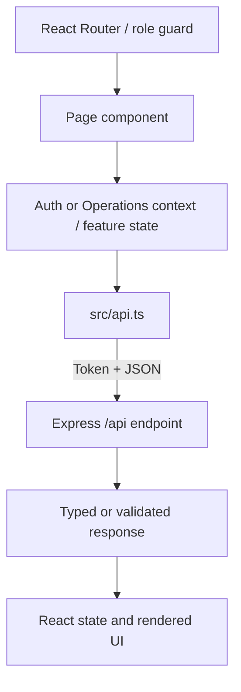
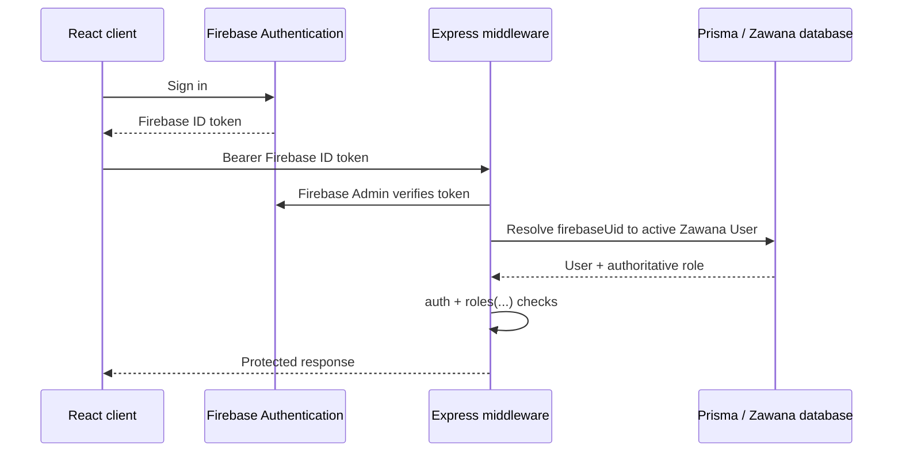

# Architecture guide

## Runtime overview

The browser UI, API, and database have separate responsibilities. Identity tokens prove who signed in; the application database supplies Zawana roles and business data.

```mermaid
flowchart LR
  Browser[React + Vite] --> ApiClient[src/api.ts]
  ApiClient -->|Bearer token| Express[Active Express app\nbackend/src/server.ts]
  Express --> AuthRouter[/api/auth router]
  Express --> DomainRoutes[Legacy and extracted domain routes]
  AuthRouter --> AuthService[Auth validation and service]
  AuthService --> Identity[Firebase Admin or local DB session]
  Express --> Middleware[Authentication and role middleware]
  Middleware --> User[Application User + database role]
  DomainRoutes --> Prisma[Shared Prisma Client]
  AuthService --> Prisma
  Prisma --> SQLite[(SQLite local)]
  Prisma --> PostgreSQL[(PostgreSQL deployment)]
  DomainRoutes --> Notifications[Notification records]
```

## Frontend request path



`src/App.tsx` composes routes and role guards. `RoleLayout.tsx` provides shared navigation. Page modules remain mostly under `src/pages`; contexts and the shared API client are the current cross-page layers. Some larger pages still combine orchestration and view logic, so feature-level extraction remains incremental technical debt rather than a completed migration.

## Authentication and authorization

### Local database mode

```mermaid
sequenceDiagram
  participant UI as React client
  participant API as Express auth router
  participant DB as Prisma / SQLite
  UI->>API: POST /api/auth/login { username, password }
  API->>DB: Find active user; verify password hash
  DB-->>API: User with database role
  API-->>UI: Safe user + signed local session token
  UI->>API: Protected request with Bearer token
  API->>DB: Verify token subject and reload active user/role
  API-->>UI: Authorized resource or 401/403
```

Database-backed auth is explicitly local-development-only. Configuration rejects `AUTH_MODE=database` when `NODE_ENV=production` or `DATABASE_URL` is not a `file:` SQLite URL. A 32-character minimum random `JWT_SECRET` is required. The API reloads role and active status from the database for protected requests; role claims from the browser are not trusted.

### Firebase mode



Firebase verifies external identity. The Zawana database remains authoritative for app profiles, role permissions, bookings, packages, transactions, and notifications. Firebase Admin credentials must remain server-side.

## Backend runtime and route ownership

`backend/package.json` scripts start and compile `backend/src/server.ts`. This is the active Express application. It configures CORS/body parsing/uploads, mounts the auth/store/menu routers, runs legacy SQLite compatibility setup, declares many domain routes, and starts listening. `backend/src/app.ts` is an older modular composition that package scripts do not import; several routes overlap. Do not switch entrypoints until endpoint parity, middleware order, and business behavior are explicitly verified.

Auth is the first extracted backend domain:

```text
backend/src/routes/auth.ts                 HTTP route declarations
backend/src/modules/auth/auth.validation.ts Zod input schemas and normalization
backend/src/modules/auth/auth.service.ts    Identity/account/session workflows
backend/src/middleware/auth.ts              Token verification + DB user resolution
backend/src/middleware/rateLimit.ts         Shared request limiter factory
backend/src/services/databaseSession.ts     Local signed session tokens
backend/src/services/firebaseAdmin.ts       Firebase Admin adapter
backend/src/services/userSerializer.ts      Safe application-user response shape
backend/src/config/env.ts                   Validated runtime configuration
backend/src/lib/prisma.ts                   Shared Prisma Client
```

Profile and most other domain handlers remain in `server.ts`. Future extraction should move one domain at a time and preserve route paths, role checks, validation, Prisma transaction boundaries, and response shape.

## Database access

`lib/prisma.ts` exports one Prisma Client instance for the active process and imported route modules. SQLite and PostgreSQL use separate Prisma schemas and migration histories:

- `backend/prisma/schema.prisma` and `backend/prisma/migrations/` for local SQLite
- `backend/prisma/postgresql/schema.prisma` and `backend/prisma/postgresql/migrations/` for PostgreSQL

Use the matching generate/migrate script. Do not copy migration files between providers or reset a database as part of a structural refactor.

## Domain map

- **Users/auth:** `User` is the Zawana application identity and role anchor. Firebase identity links through `firebaseUid`; local mode uses a DB password hash.
- **Bookings/badminton:** court rentals and private courses are represented by booking records and share court conflict logic. Payment and reservation status transitions are handled by the active route logic and transaction tables.
- **Packages/memberships:** package catalog and member enrollments/purchases feed the member experience and operational views.
- **Notifications:** notification records are persisted in the database and surfaced to role-specific users.
- **Operations:** clinic, gym, store, cafe, finance, content, and dashboards use the same user/role system, with some routes extracted and others still hosted in `server.ts`.

See `docs/API.md` for selected endpoint contracts. The Prisma schemas and active route declarations remain the source of truth for implementation details.

## Refactoring guardrails and remaining debt

- `server.ts` is still large and mixes bootstrap, SQL portability helpers, runtime compatibility setup, HTTP handlers, and business rules.
- `app.ts` is not the active bootstrap and should not be adopted until the mounted-route map is reconciled.
- Some frontend pages/contexts and server handlers still use broad types or inline logic.
- SQLite compatibility schema setup runs at startup; production PostgreSQL migration behavior is separate.
- No schema changes were introduced by the auth/config extraction.

Use the assessment in `docs/REFACTORING_ASSESSMENT.md` to guide safe domain-by-domain cleanup.
