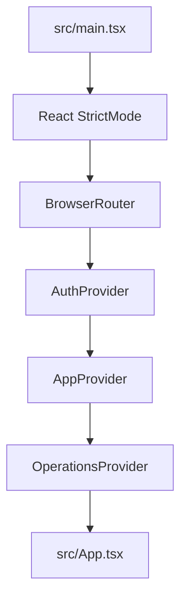
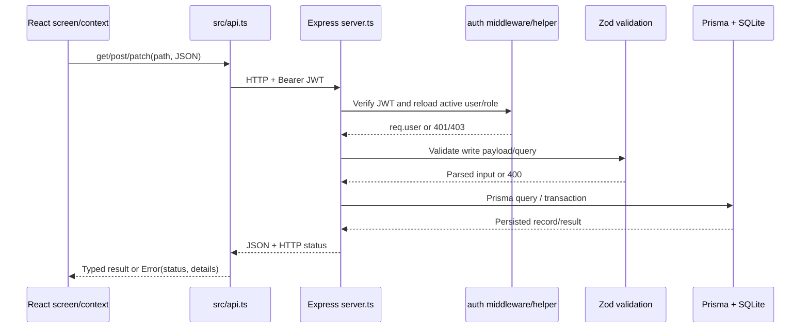
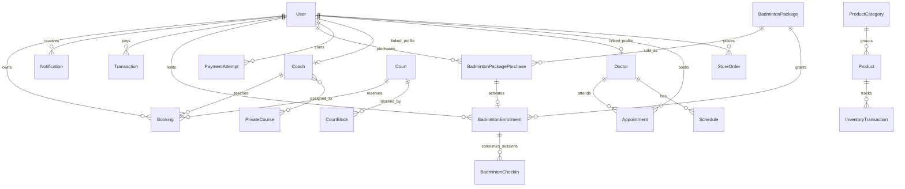
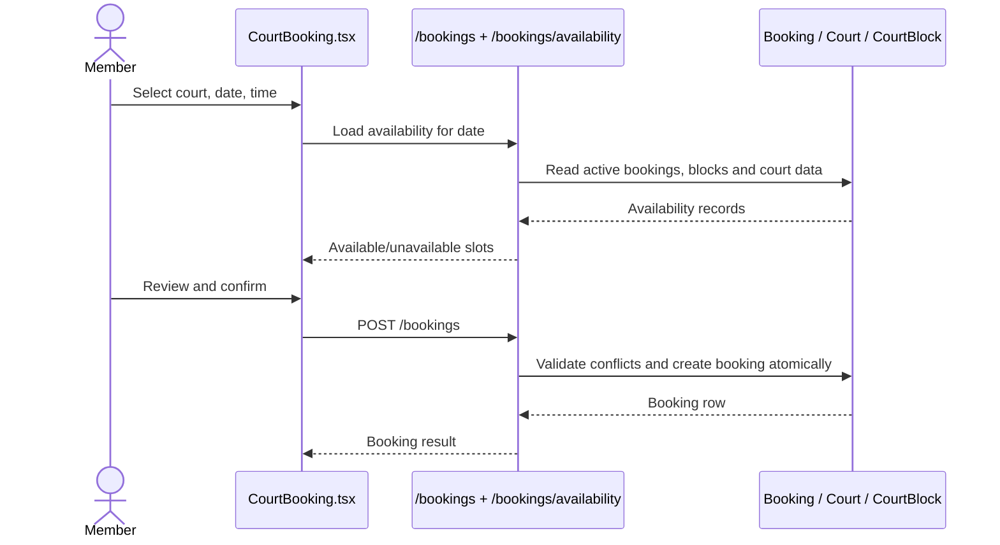
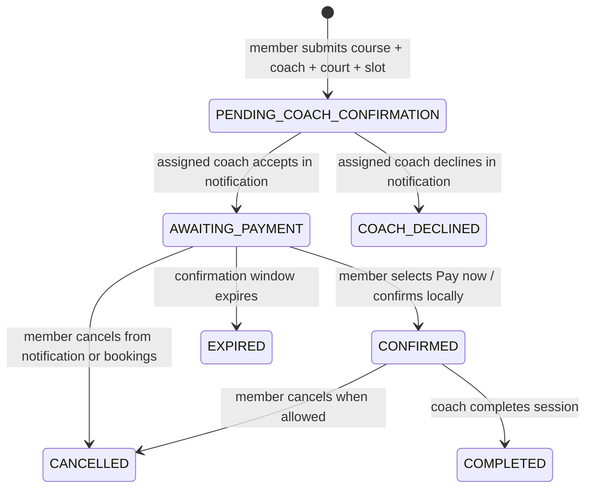

# Zawana Life — System Architecture and Code Guide

This document describes the application in this repository as it is currently wired. It covers the browser app, API, database, authentication, main workflows, and the responsibilities of the important source files. It is an architecture guide, not a line-by-line commentary on every JSX element.

## 1. System at a glance

```mermaid
flowchart LR
  Browser[Member / Coach / Admin / FO browser]
  Vite[Vite dev server or static frontend]
  React[React + TypeScript UI]
  Router[React Router routes and role guards]
  Contexts[Auth / App / Operations contexts]
  APIClient[src/api.ts: fetch + bearer token]
  Express[Express API: backend/src/server.ts]
  Auth[JWT verification + current DB role]
  Validation[Zod request validation]
  Handlers[Booking, package, notification, admin handlers]
  StoreMenu[Mounted Store and Menu Express routers]
  Prisma[Prisma Client]
  SQLite[(SQLite database by default)]
  KPay[KPay adapter and signed webhook]
  Uploads[Coach and course image files]

  Browser --> Vite --> React --> Router --> Contexts
  Contexts --> APIClient
  APIClient -->|HTTP JSON + Bearer JWT| Express
  Express --> Auth --> Validation --> Handlers --> Prisma --> SQLite
  Express --> StoreMenu --> Prisma
  Handlers -->|checkout request| KPay
  KPay -->|signed webhook| Express
  Handlers --> Uploads
```



### Main runtime processes

| Process | Entry point | Port / output | Purpose |
|---|---|---|---|
| Frontend dev server | Root `pnpm run dev` → Vite | Usually `5173` | Serves React and compiles TypeScript/JSX during development. |
| Backend dev server | Root `pnpm run api` → `backend/src/server.ts` via `tsx watch` | `PORT`, default `8000` | Serves the JSON API, auth, bookings, packages, notifications, and operational endpoints. |
| Backend production build | `pnpm --dir backend run build` | `backend/dist/src/server.js` | Compiled API entrypoint. |
| Database | Prisma datasource | SQLite by default | Stores users, bookings, courses, packages, transactions, and operational records. |

The browser’s API origin is `VITE_API_URL`, defaulting to `http://localhost:8000/api`.

## 2. Frontend architecture

### Startup and provider tree

`src/main.tsx` mounts the app with providers in this order:



- **AuthProvider** restores the stored token by requesting `/auth/me`, and exposes login, signup, logout, and the current account.
- **AppProvider** loads general booking and notification summaries used by member-oriented screens.
- **OperationsProvider** loads the operational datasets needed by staff dashboards. Requests are selected according to the signed-in role and settled independently so one failed dataset does not reject every other result.
- **App** declares public, member, staff, coach, and admin routes.

### Network and session handling

`src/api.ts` is the shared HTTP client:

1. Builds the URL from `VITE_API_URL` plus the API path.
2. Adds JSON content type when a request has a body.
3. Adds `Authorization: Bearer <token>` when signed in.
4. Parses JSON and converts non-2xx responses into errors carrying status and validation/conflict detail.
5. Exposes `get`, `post`, `patch`, `put`, and `del` helpers.

The JWT is kept in `localStorage` under `zawana_access_token`. The API verifies the token, then reloads the user from the database for each authenticated request. Authorization therefore uses the current database role and active flag rather than trusting only the role embedded when the token was issued.

### Route and layout model

`src/App.tsx` owns route definitions. Its `Guard` checks for an authenticated account and exact expected role, then places members inside `AppLayout` and staff inside `RoleLayout`.

| Route family | Main screens |
|---|---|
| Public | Home, facilities, memberships info, coaches info, contact, login, signup |
| Member | `/member`, `/book/court`, `/private-course`, `/bookings`, `/membership`, `/payments`, profile, notifications, performance, training, store, cafe |
| Admin | `/admin`, users, courts, coaches, private-course catalog/history, badminton/gym packages, finance, CMS |
| Badminton FO | Dashboard, package check-in/sales, court desk, bookings, POS, transactions |
| Gym FO | Dashboard, check-in, members, memberships, appointments, coaches, payments |
| Clinic FO | Dashboard, appointments, patients, doctors, schedule, records, payments |
| Store FO | Dashboard, products, categories, inventory, POS, orders, transactions |
| Cafe FO | Dashboard, orders, menu, POS, transactions |
| Coach | Dashboard, calendar, assigned bookings/requests, clients, notifications |
| Doctor | Dashboard, schedule, appointments, patients, profile, notifications |
| Owner | Read-only cross-business overview and finance |

`src/components/RoleLayout.tsx` supplies the staff sidebar, profile identity, mobile navigation, and notification bell. `src/layouts/Layouts.tsx` provides the separate member layout and mobile/desktop member navigation.

### Main frontend directories and responsibilities

| Path | Responsibility |
|---|---|
| `src/App.tsx` | Route declarations, auth guards, redirects, and page/layout composition. |
| `src/api.ts` | API base URL, auth header, JSON requests, and response errors. |
| `src/types/index.ts` | Shared UI-facing role and domain types. The Prisma schema remains the database contract. |
| `src/context/AuthContext.tsx` | Authenticated user, token restoration, login/signup/logout. |
| `src/context/AppContext.tsx` | General bookings and active notifications for shared/member UI. |
| `src/context/OperationsContext.tsx` | Role-scoped operational data and write helpers for staff screens. |
| `src/pages/Operations.tsx` | Shared staff operations view: dashboards, booking queues, check-in, POS, finance, and notification actions. Content is selected from role plus route. |
| `src/pages/CourtBooking.tsx` | Member court selection, dates/slots, booking summary and confirmation request. |
| `src/pages/PrivateCourse.tsx` | Course → assigned coach → court → date/time request UI. |
| `src/pages/Bookings.tsx` | Member booking history, cancellation and private-course confirmation/payment step. |
| `src/pages/PrivateCourseAdmin.tsx` | Admin course catalog editor and private-course request history. |
| `src/pages/CoachCalendar.tsx` | Coach calendar view backed by assigned booking events. |
| `src/pages/Membership.tsx` | Member badminton packages and member package purchase/check-in data. |
| `src/components/NotificationBell.tsx` | Polling notification popover, unread count, optional sound, and context-sensitive actions. |
| `src/components/UI.tsx` | Shared visual primitives: buttons, cards, badges, page shell, stats, empty states, pagination, toast. |
| `src/data/index.ts` | Remaining static presentation/catalog data. Persisted workflows should use API data rather than treating this file as a database. |

## 3. Backend architecture

### Important runtime distinction

The scripts in `backend/package.json` start `backend/src/server.ts`. That is the **active API entrypoint**. Most endpoints are defined directly in that file. It also mounts:

- `backend/src/routes/store.ts` at `/api/store`
- `backend/src/routes/menu.ts` at `/api/menu`

`backend/src/app.ts` is a separate modular Express app that imports many routers, but current `dev`/`start` scripts do not use it. Those modular files are not automatically the active implementation just because they exist. Check/update the package scripts before moving endpoint ownership to `app.ts`.

The active server and mounted Store/Menu routers each use Prisma clients from their respective source modules. They connect to the configured database, but this is a parallel structure that should be consolidated deliberately if the backend is refactored.

### Request lifecycle



### Backend source map

| Path | Responsibility |
|---|---|
| `backend/src/server.ts` | Active Express server, middleware, JWT/password auth, permissions, most API handlers, reservation expiry, availability checks, transactions, notifications, and KPay callback. |
| `backend/src/services/kpay.ts` | KPay adapter contract, outbound checkout request, configuration check, and HMAC webhook-signature validation. |
| `backend/src/routes/store.ts` | Modular Store API routes for product/category/inventory/store-order functions; mounted by the active server. |
| `backend/src/routes/menu.ts` | Modular Cafe menu routes; mounted by the active server. |
| `backend/src/routes/*.ts` | Additional modular route implementations. They are architectural reference/parallel code until mounted by the active server. |
| `backend/src/middleware/auth.ts` | Reusable auth/role middleware for modular routers. |
| `backend/src/middleware/errorHandler.ts` | Modular-app not-found and error handling. Active `server.ts` has its own final error handlers. |
| `backend/src/lib/prisma.ts` | Prisma singleton used by modular routes. |
| `backend/src/utils/helpers.ts` | Shared date/code/helper functions used by modular routes. |
| `backend/src/types/auth.ts` | Auth request/user types for modular middleware. |
| `backend/prisma/schema.prisma` | Database model, relations, enums, defaults and indexes. |
| `backend/prisma/migrations/` | Ordered SQL migrations for schema evolution. |
| `backend/prisma/seed.ts` | Development/demo data and accounts. |

### API area index

The active API uses the `/api` prefix. Important areas include:

| Area | Representative endpoints | Main purpose |
|---|---|---|
| Health/auth | `GET /health`, `POST /auth/register`, `POST /auth/login`, `GET /auth/me` | Service check, member registration, login and session restoration. |
| Users | `GET/POST /users`, `PATCH /users/:id`, `GET /users/:id/activity` | Admin account management; Owner has read access to the user list only. |
| Courts/blocks | `/courts`, `/court-blocks`, `/badminton/date-overrides` | Court catalog, recurring court blocks, holiday/open/closed date overrides. |
| Coaches/doctors/schedules | `/coaches`, `/doctors`, `/schedules` | Coach profiles and images, doctor records and clinic schedules. Badminton coaches do not configure weekly availability. |
| Bookings | `/bookings`, `/bookings/availability`, `/bookings/month-availability` | Court, training and private-course booking reads/writes, calendar availability, conflict validation and status changes. |
| Private course | `/private-courses`, `/member/private-courses`, `/coach/private-courses`, `/coach/calendar`, `/coach/private-courses/:id/decision` | Course catalog, member request creation/history, coach review and assigned sessions. |
| Member confirmation/cancellation | `/member/private-courses/:id/pay`, `/member/private-courses/:id/cancel` | The `pay` path currently confirms the accepted reservation locally without opening KPay; payment remains pending. Cancellation releases the reservation. |
| Badminton package | `/packages/badminton`, `/member/badminton-packages/:id/purchase`, `/badminton/enrollments`, `/badminton/check-ins` | Package catalog/purchases, FO package activation and session check-ins. |
| Gym package/membership | `/packages/gym`, `/memberships` | Existing gym membership administration and records. |
| Finance | `/transactions`, `/analytics/overview`, `/dashboard` | Transactions, business summaries and role-specific overview metrics. |
| Notifications | `/notifications`, `/notifications/:id/read` | Active inbox, read state, audience targeting and notification action metadata. |
| Store | `/store/*`, `/products`, `/inventory` | Products, inventory movements, categories, imports and orders. |
| Cafe | `/menu`, `/cafe/orders`, `/cafe/orders/:id/status` | Cafe catalog and order lifecycle. |
| Clinic | `/appointments`, `/clinic/member-accounts`, `/schedules` | Clinic appointment and doctor schedule flows. |
| Content | `/content`, `/admin/content` | Published public content and admin content management. |
| Payment adapter | `/payments/:id`, `POST /payments/kpay/webhook` | Read payment-attempt status and accept only signed provider callbacks for payment success. |

## 4. Authentication, roles and authorization

### Sign-in

1. `POST /api/auth/login` receives email/password.
2. Backend looks up the user and verifies the bcrypt password hash.
3. Backend returns user data and a signed JWT.
4. Frontend stores the token and user in AuthContext/local storage.
5. Later requests attach the bearer token.
6. The active backend verifies the token and reloads user `id`, `role`, `name`, `email`, and `active` from Prisma.

### Role model

Roles are stored by the Prisma `Role` enum: `member`, `coach`, `admin`, `owner`, `gym_fo`, `clinic_fo`, `badminton_fo`, `store_fo`, `cafe_fo`, and `doctor`.

- **Member**: own bookings, package, notifications, profile and purchase/confirmation paths.
- **Coach**: bookings assigned through the linked `Coach.userId`; can decide their own pending requests and view their calendar.
- **Admin**: central operational and content administration, including account/course/coach management.
- **Owner**: overview/financial/read views; mutation routes remain restricted to Admin or the relevant operations role.
- **Front-office roles**: scoped work for their business or department.
- **Doctor**: assigned clinical appointments and permitted patient workflows.

Frontend guards improve navigation but are not the security boundary. Backend `auth` and `roles(...)` checks plus per-record ownership checks are the enforcement boundary.

## 5. Database architecture

The Prisma datasource defaults to SQLite and reads `DATABASE_URL` from `backend/.env`. The schema is organized around one `User` identity with domain-specific records attached by foreign keys where appropriate.

### Database relationship view



**Private-course catalog link note:** a `Booking` stores the selected course identifier/title in its `meta` JSON string; the booking has direct foreign keys to the assigned `Coach` and `Court`, but the Prisma schema does not currently define a `Booking.privateCourseId` foreign key. Historical course booking references therefore rely partly on metadata and the persisted title/price snapshot.

**Payment attempt link note:** `PaymentAttempt.resourceType` + `resourceId` is polymorphic text, not a foreign key. The signed webhook must resolve and validate the actual resource before applying success.

### Model groups

| Domain | Models | Use |
|---|---|---|
| Identity | `User`, `Coach`, `Doctor` | Authentication, roles, and linked coach/doctor profiles. Coach profile has optional image and department. |
| Badminton facilities | `Court`, `CourtBlock`, `CourtDateOverride`, `HolidayRate` | Court catalog, unavailable recurring/date-specific periods, open/closed overrides and pricing exceptions. |
| Booking/coaching | `Booking`, `PrivateCourse`, `Class` | Shared booking timeline, private-course catalog, coach associations and legacy class catalog. |
| Clinic | `Appointment`, `Schedule` | Patient appointment and doctor scheduling records. `ScheduleRole` is doctor-specific. |
| Packages | `BadmintonPackage`, `BadmintonPackageCategory`, `BadmintonPackagePurchase`, `BadmintonEnrollment`, `BadmintonCheckIn`, `GymPackage`, `MembershipPlan`, `Membership` | Catalog, purchase/entitlement, remaining badminton sessions, check-in history and retained gym entities. |
| Money | `Transaction`, `PaymentAttempt` | Recorded business transactions and provider checkout attempts. `Transaction` is the finance ledger view; payment attempts are provider workflow state. |
| Notifications | `Notification` | Active inbox/history metadata, recipient/audience, action target, read and active-in-inbox state. |
| Store/cafe | `ProductCategory`, `Product`, `InventoryTransaction`, `StoreOrder`, `CafeMenuItem`, `CafeOrder` | Retail inventory and orders, plus cafe menu/orders. |
| Content/legacy | `ContentItem`, `Student` | Published/admin-managed content and retained academy student records. New identity flows use `User`. |

### State and index conventions

- Booking status and payment status are separate concepts: `BookingStatus` describes reservation lifecycle; `PaymentStatus` describes money collection.
- Private-course lifecycle values include `PENDING_COACH_CONFIRMATION`, `AWAITING_PAYMENT`, `CONFIRMED`, `COACH_DECLINED`, `CANCELLED`, `COMPLETED`, and `EXPIRED`.
- Availability queries are supported by indexes over user/created, court/date/status, coach/date/status, and private-course payment expiry.
- Session check-ins are separate rows under `BadmintonCheckIn`, allowing an audit of consumption rather than only a remaining-session counter.

## 6. Main business workflows

### Court rental



The backend rechecks conflicts during creation; frontend availability is only for user experience. Court blocks, active reservations and other occupying bookings share the availability calculation. Court rental creates a booking through the booking handler; checkout UI submits the booking itself rather than using a separate mock availability store.

### Private-course booking and notification actions



1. Member selects an active course, one of its assigned linked badminton coaches, an available court, and a date/time.
2. `POST /api/member/private-courses` validates course/coach/court links, date/time, court blocks and current conflicts in a transaction. It creates a booking with `PENDING_COACH_CONFIRMATION` and notifies both sides.
3. Coach accepts/declines from the notification bell or notification center. The server verifies the request belongs to that coach. Accept rechecks court/coach conflicts and sets a 24-hour `AWAITING_PAYMENT` deadline. Decline releases the slot and notifies the member.
4. Member’s coach-confirmed notification offers **Pay now** and **Cancel booking**. In the current code, **Pay now** calls `/member/private-courses/:id/pay`, which confirms the booking in-app, keeps `paymentStatus` pending, records no paid transaction, and does not open KPay. It is an interim reservation confirmation, not evidence of payment.
5. The booking history also exposes that confirmation/cancellation path. The coach sees assigned booking/calendar data.

### Badminton packages and check-in

1. Admin/Badminton FO maintains the badminton package catalog.
2. A member package purchase is stored as a `BadmintonPackagePurchase`; payment activation paths create/update an enrollment when payment is settled by the configured workflow.
3. Staff package sales can create an enrollment for an account member or a walk-in using the existing `BadmintonEnrollment` model.
4. Check-in validates enrollment state, expiry, and remaining sessions on the API, records `BadmintonCheckIn`, and updates remaining sessions.
5. Dashboard package card/history should be sourced from member endpoints and the linked enrollment rows.

### Payments and KPay boundary

`backend/src/services/kpay.ts` is an adapter boundary. Checkout creation requires adapter URL/API key, and payment success is accepted by `/api/payments/kpay/webhook` only when the raw request body has a valid HMAC signature. The webhook updates the payment attempt and related service/booking inside database transactions, then creates ledger and notification records.

The private-course **Pay now** action described above intentionally does not use the KPay adapter right now. Other configured purchase/checkout paths can still call `startKPayAttempt`; payment environment variables are listed below.

### Notifications

- API creates notifications with recipient or audience, title/body, route, icon/image, action label, entity type/id.
- Bell polls `/notifications` and renders unread count; optional sound is limited to newly observed unread items after user interaction enables audio.
- Coach request notifications contain Accept/Decline actions.
- Coach-accepted private-course notifications contain the member Pay now/Cancel actions.
- Action handlers call the corresponding API first, then mark/remove the notification from the active inbox. Notification records remain available as audit/history data.

## 7. API security and consistency rules

- Never trust a frontend role check as authorization. Every write route must validate the JWT role server-side.
- Member booking reads and mutations must be scoped to `req.user.id`.
- Coach actions must compare the booking’s `coachId` with the coach profile linked to `req.user.id`.
- Booking/payment status changes should be server-generated, not accepted as arbitrary client status strings.
- Court and coach conflicts must be checked again on the backend inside a transaction or equivalent concurrency-safe section.
- Payment success must come from a verified provider webhook, not a browser callback.
- When cancelling/declining/expiring, release the reservation and update associated notifications/attempt state.
- Zod is used for many request payloads; common errors are translated into structured JSON by the active server’s error middleware at the bottom of `server.ts`.

## 8. Environment and local development

Root `.env.example`:

```dotenv
VITE_API_URL=http://localhost:8000/api
```

`backend/.env.example`:

```dotenv
DATABASE_URL="file:./dev.db"
# Set JWT_SECRET locally to a generated random value of at least 32 characters.
PORT=8000
CLIENT_URL="http://localhost:5173"
PUBLIC_API_URL="http://localhost:8000"
```

KPay adapter variables are optional until a merchant adapter is configured:

```dotenv
KPAY_CHECKOUT_ADAPTER_URL=
KPAY_ADAPTER_API_KEY=
KPAY_WEBHOOK_SECRET=
KPAY_CALLBACK_URL=
```

Typical local startup commands (run from the indicated folders):

```powershell
# Backend
cd backend
pnpm --dir backend run prisma:generate
pnpm --dir backend run prisma:migrate
pnpm run api

# Frontend, from the repository root in another terminal
pnpm run dev
```

`backend/prisma/seed.ts` seeds development data. Do not run seeding against a database containing data you need to preserve without first checking the seed implementation.

## 9. Architecture caveats and current boundaries

1. **Two backend layouts exist.** The running server is the monolithic `backend/src/server.ts`; `backend/src/app.ts` and many neighboring routers are not the code path used by current scripts, except Store/Menu routers explicitly mounted by `server.ts`.
2. **Database links are not uniformly relational.** PrivateCourse-to-Booking is stored in booking metadata, and `PaymentAttempt` references different resource types through a polymorphic string pair.
3. **Payment and reservation state differ.** A booking may be confirmed while payment remains pending, particularly for the temporary private-course flow. Do not display it as paid or include it as a paid transaction until money is actually collected.
4. **Some legacy domain models remain.** `Student`, generic `MembershipPlan`/`Membership`, and static UI data have persisted/legacy consumers; removing them requires a usage audit.
5. **SQLite is the default.** Moving to PostgreSQL requires checking JSON field behavior, raw SQL in `server.ts`, migrations, and any SQLite-specific query expressions.
6. **Build and runtime can disagree if duplicate servers are running.** Restart the API process after changes and confirm the browser is reaching the current backend on the configured host/port.

## 10. Important code reading path

For a practical walkthrough, read files in this order:

1. `src/main.tsx` — app startup and providers.
2. `src/App.tsx` — route map and role guards.
3. `src/api.ts` — HTTP/auth header behavior.
4. `src/context/AuthContext.tsx` and `src/context/OperationsContext.tsx` — client session and data loading.
5. A screen such as `src/pages/CourtBooking.tsx` or `src/pages/PrivateCourse.tsx` — UI state and user actions.
6. The matching handler in `backend/src/server.ts` — validation, authorization and persistence.
7. The relevant models in `backend/prisma/schema.prisma` — data shape and foreign keys.
8. The newest relevant file under `backend/prisma/migrations/` — how the schema reached its current state.

This sequence follows the actual request path from user interaction to persisted row and back to rendered state.
